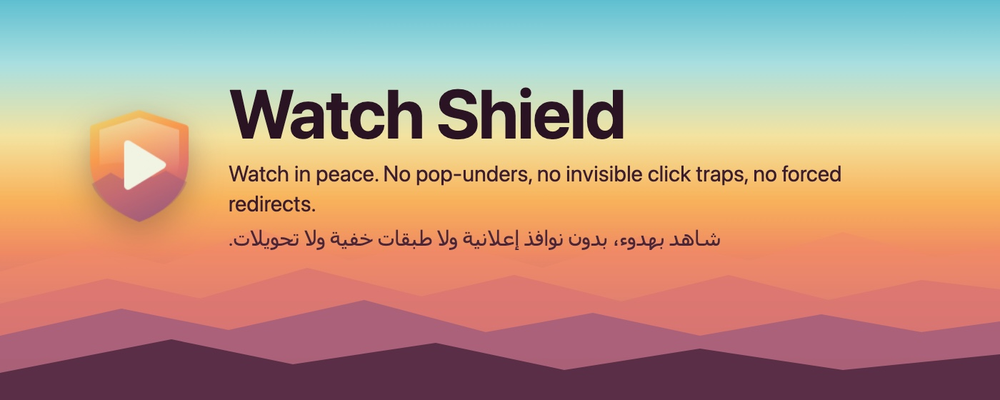
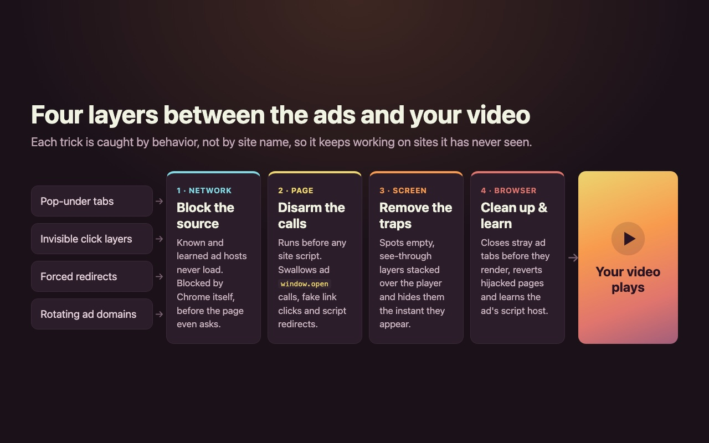
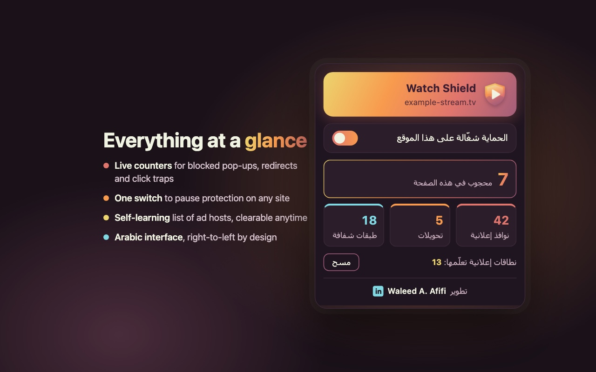

<p align="center">
  
</p>

<p align="center">
  
  
  
  
</p>

# Watch Shield

**Watch Shield** is a Chrome extension for people who watch movies, series and live matches on free
streaming sites. Those sites are built to make you click on ads: every tap on the player opens a new tab,
an invisible layer sits on top of the video, and the page can jump to an ad on its own while you wait.

Watch Shield stops all of that. It doesn't depend on a list of known sites. It recognizes **how** ads
behave, so it keeps working on sites it has never seen before.

## Features

- **No more pop-under tabs.** Clicks on the player no longer open ad tabs, including the ones that open
  an empty tab first and send it to the ad a moment later.
- **Invisible click traps removed.** Transparent layers stacked over the player are hidden the instant they
  appear, even when the site recreates them every few milliseconds.
- **No forced redirects.** If the page tries to leave for another site without you clicking anything,
  the navigation is cancelled, or reverted if it gets through.
- **Learns as you watch.** When an ad script is caught, its host is remembered and blocked on every site
  from then on.
- **Stays out of the way.** Sign-in windows (Google, Apple, Microsoft, PayPal…) and links you really click
  always work. You can pause protection for any single site with one switch.
- **Private by design.** Nothing leaves your browser. No analytics, no accounts, no remote servers.

## How it works

<p align="center">
  
</p>

| Layer | What it does | Code |
|---|---|---|
| **1 · Network** | Known and learned ad hosts are blocked by Chrome before they load. | [`rules/ad-hosts.json`](rules/ad-hosts.json), [`src/background.js`](src/background.js) |
| **2 · Page** | Runs before any site script, in every frame. Disarms ad `window.open` calls, synthetic link clicks, borrowed iframe windows and script-driven redirects. | [`src/main-world.js`](src/main-world.js) |
| **3 · Screen** | Detects big, empty, see-through layers stacked above the player and hides them, both when they're added and at the moment you click. | [`src/isolated.js`](src/isolated.js) |
| **4 · Browser** | Closes any ad tab that slips through before it renders, reverts hijacked pages and learns the ad's script host. | [`src/background.js`](src/background.js) |

All the decisions (what counts as an ad tab, what counts as a hijack) live in one small, tested module:
[`src/shared.js`](src/shared.js).

## The popup

<p align="center">
  
</p>

- How many things were blocked on the current page, plus totals for ad tabs, redirects and click traps.
- A switch to turn protection off for the current site if something ever breaks.
- The number of ad hosts the extension has learned, with a button to clear them.

The interface is in Arabic and designed right-to-left.

## Install

Watch Shield isn't on the Chrome Web Store yet. To install it from source:

1. Download this repository (**Code → Download ZIP**) and unzip it, or clone it:
   ```bash
   git clone https://github.com/waleedafifi90/ads-blocker.git
   ```
2. Open `chrome://extensions` and turn on **Developer mode** (top right).
3. Click **Load unpacked** and select the project folder.
4. Pin the shield icon to your toolbar.

After pulling new changes, press the ↻ button on the extension's card to reload it.

## Development

```bash
npm test
```

The decision logic is covered by unit tests (Node's built-in test runner, no dependencies).
Page behavior, such as overlays and pop-ups, has to be verified in a real browser on a real site.

```
.
├── manifest.json
├── src/
│   ├── background.js    # service worker: tab closing, redirect reverting, learned rules
│   ├── main-world.js    # page-world guard: window.open, fake clicks, Navigation API
│   ├── isolated.js      # click-trap detection and user-click reporting
│   └── shared.js        # pure decision logic (tested)
├── popup/               # the toolbar popup (Arabic, RTL)
├── rules/ad-hosts.json  # static blocklist
├── icons/               # extension icons + source SVG
├── docs/images/         # README and store images
└── test/                # unit tests
```

## Chrome Web Store assets

Ready-to-upload images that match the store's requirements, in [`docs/images`](docs/images):

| File | Use | Size |
|---|---|---|
| `store-icon-128.png` | Store icon | 128×128, 96×96 artwork with transparent padding |
| `screenshot-1.jpg`, `screenshot-2.jpg` | Screenshots | 1280×800, no transparency |
| `tile.jpg` | Small promo tile | 440×280, no transparency |
| `marquee.jpg` | Marquee promo tile | 1400×560, no transparency |

## نبذة بالعربي

**Watch Shield** إضافة لمتصفح كروم مخصّصة لمواقع مشاهدة الأفلام والمسلسلات والمباريات. تمنع النوافذ الإعلانية
التي تُفتح مع كل نقرة على المشغّل، وتزيل الطبقات الشفافة الموضوعة فوق الفيديو، وتلغي التحويل التلقائي إلى صفحات
الإعلانات. لا تعتمد الإضافة على قائمة مواقع، بل تتعرّف على سلوك الإعلان نفسه، وكلما رصدت مصدرًا إعلانيًا جديدًا
تعلّمته وحجبته على جميع المواقع.

## Developer

Designed and developed by **Waleed A. Afifi**
[](https://www.linkedin.com/in/walafifi/)
